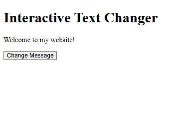
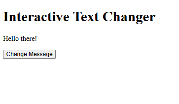
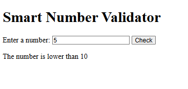
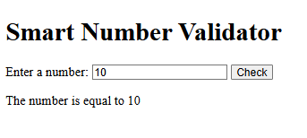
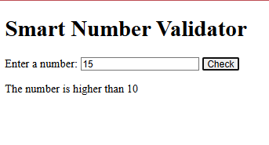
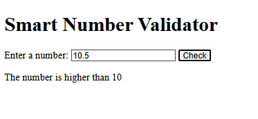
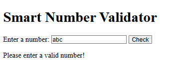
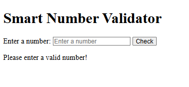
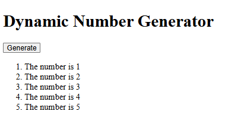
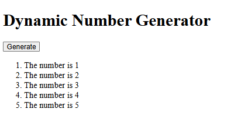

# BIC21203 Web Development - Lab 4a: JavaScript

**Course:** BIC21203 Web Development
**Name:** Muhamad Danish Farhan Bin Mohd Fuzi
**Student ID:** AI240022
**Section:** 8
**Session:** 2026/2027 Sem1

## About This Lab

In this lab I made 3 small web pages using JavaScript. The pages can change text, check what the user types, and make a list by themselves. I used only HTML and JavaScript (no libraries).

## How to Run

1. Download this repository.
2. Open the folder `Q1`, `Q2` or `Q3`.
3. Double-click `index.html` to open it in your browser (Chrome, Edge or Firefox).

## Q1 - Text Changer

**What it does:** The page first shows "Welcome to my website!". When you click the **Change Message** button, the text changes to "Hello there!".

**How I did it:**
- I found the paragraph and the button using `getElementById()`.
- I wrote a function called `changeMessage()` that changes the text.
- I connected the button to the function using `addEventListener()`.

| Before click | After click |
|---|---|
|  |  |

## Q2 - Number Checker

**What it does:** You type a number and click **Check**. The page tells you if the number is lower than, higher than, or equal to 10. If you type something that is not a number (or leave it empty), it says "Please enter a valid number!".

**How I did it:**
- I read the input and removed extra spaces using `trim()`.
- I checked for empty input first.
- I changed the text into a number using `Number()`, and used `Number.isNaN()` to catch things like "abc".
- I used `if...else if...else` to choose the right message.
- I showed the message using `textContent`.

**Test results:**

| I typed | The page said | Screenshot |
|---|---|---|
| 5 | The number is lower than 10 |  |
| 10 | The number is equal to 10 |  |
| 15 | The number is higher than 10 |  |
| 10.5 | The number is higher than 10 |  |
| abc | Please enter a valid number! |  |
| (empty) | Please enter a valid number! |  |

## Q3 - Number List Maker

**What it does:** When you click **Generate**, the page makes a list: "The number is 1" up to "The number is 5". If you click again, the list stays at 5 items (no repeats).

**How I did it:**
- The function `generateNumbers()` first clears the old list using `replaceChildren()`.
- A `for` loop counts from 1 to 5.
- For each number, I made a new `<li>` using `createElement()`, put the text inside using `textContent`, and added it to the list using `appendChild()`.

| After first click | After many clicks (still 5 items) |
|---|---|
|  |  |

## What I Learned

- How to find things on a page with JavaScript
- How to make a button do something when clicked
- How to check user input and show the right message
- How to use a loop to make many items quickly
- Why `textContent` is safer than `innerHTML`