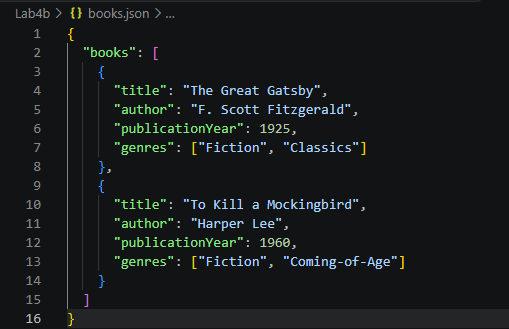
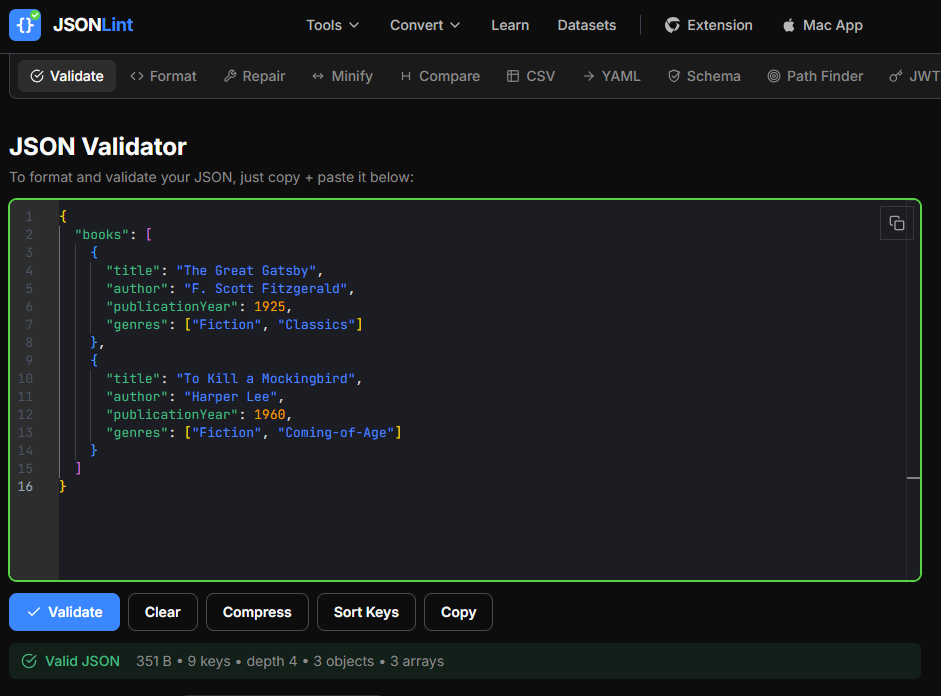
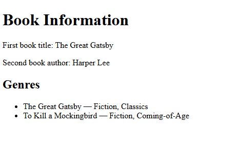
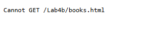
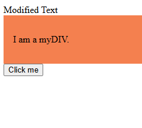
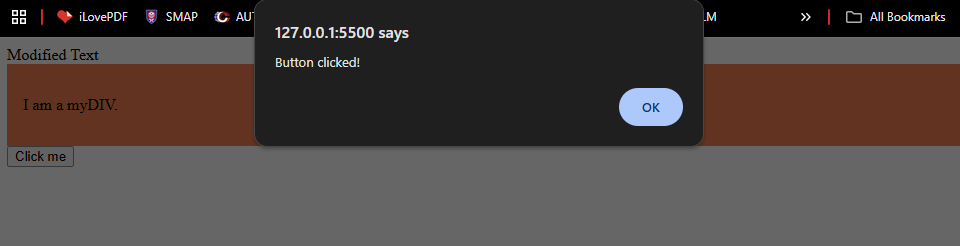

# BIC21203 Web Development - Lab 4b: JSON and jQuery

**Course:** BIC21203 Web Development
**Name:** Muhamad Danish Farhan Bin Mohd Fuzi
**Student ID:** AI240022
**Section:** 8
**Session:** 2026/2027 Sem1

## What is this project?

This is my Lab 4b work. It has three parts:

1. **Question 1:** I made a JSON file that stores information about two books.
2. **Question 2:** I made a web page that reads the JSON file and shows the book information on the page.
3. **Question 3:** I used jQuery to change text, add a style, and show a message when a button is clicked.

## Files in this project

| File | What it does |
|---|---|
| `books.json` | Stores the two books (title, author, year, genres) |
| `books.html` | Reads `books.json` and shows the data on the page |
| `jquery-dom.html` | Shows how jQuery changes the page |

## What you need before running

- Visual Studio Code (VS Code)
- A web browser (Chrome, Edge or Firefox)
- The **Live Server** extension in VS Code
- Internet connection (jQuery loads from the internet)

## How to set up

1. Download this project, or copy it with Git:
   ```
   git clone <your-repository-url>
   ```
2. Open VS Code.
3. Click **File > Open Folder** and choose the project folder.
4. Click the Extensions icon, search for **Live Server**, and click **Install**.

## How to run each question

### Question 1: books.json

1. Open `books.json` in VS Code.
2. Copy all the text.
3. Go to [jsonlint.com](https://jsonlint.com) and paste the text.
4. Click **Validate JSON**.
5. If it says the JSON is valid, the file is correct.

### Question 2: books.html

**Important:** Do not double-click this file. The page must run on a server, or `fetch()` will not work.

1. In VS Code, right-click `books.html`.
2. Click **Open with Live Server**.
3. The browser opens the page. You will see:
   - First book title: **The Great Gatsby**
   - Second book author: **Harper Lee**
   - Genres for each book:
     - The Great Gatsby: Fiction, Classics
     - To Kill a Mockingbird: Fiction, Coming-of-Age

**To test the error message:**
1. Rename `books.json` to something else, like `bookz.json`.
2. Refresh the page. You will see a friendly error message.
3. Rename the file back to `books.json`.

### Question 3: jquery-dom.html

1. Open `jquery-dom.html` in the browser (double-click is fine).
2. You will see three things happen:
   - The text changes from "Original Text" to **"Modified Text"**
   - The box with "I am a myDIV." gets a coral background
   - When you click **Click me**, a message pops up: **"Button clicked!"**

## Native JavaScript vs jQuery

Both ways do the same job. jQuery is just shorter.

| Job | Native JavaScript | jQuery |
|---|---|---|
| Change text | `document.getElementById("myElement").textContent = "Modified Text";` | `$("#myElement").text("Modified Text");` |
| Add a style class | `document.querySelector("#myDIV").classList.add("myStyle");` | `$("#myDIV").addClass("myStyle");` |
| Click button | `document.getElementById("myButton").addEventListener("click", () => alert("Button clicked!"));` | `$("#myButton").on("click", function () { alert("Button clicked!"); });` |

**One good thing about native JavaScript:** You do not need to download any extra library. The page loads faster.

**When jQuery is still used:** Old projects already use jQuery, such as older WordPress themes. It costs too much time to rewrite them.

## Screenshots

### Question 1



### Question 2



### Question 3

